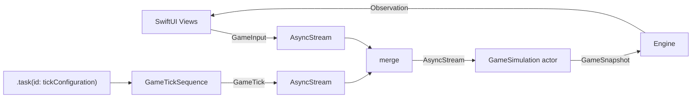

# SwiftTetris

SwiftUIだけで画面と操作を構築し、Swift Concurrencyの`AsyncSequence`でゲーム進行を管理するテトリスです。

「for await で動かすテトリス: AsyncSequenceによるSwiftUIゲームループ設計」の題材として、遊べるアプリでありながら、Swift初学者が値型、Observation、Actor、`AsyncStream`、キャンセルをコードから学べる構成を目指しています。SpriteKitは使用していません。

## 主な機能

- 7種類のテトリミノ
- 7-bag方式によるテトリミノ生成
- 自動落下、左右移動、回転
- ソフトドロップ、ハードドロップ
- ホールド、NEXT表示
- ゴースト表示
- ライン消去
- スコアとレベル
- 一時停止、ゲームオーバー、リスタート
- タップ、スワイプ、キーボード操作
- iPhone、iPad、macOSに対応する可変レイアウト

## 動作環境

- Xcode 27+
- Swift 5
- iOS / iPadOS 27.0+
- macOS 27.0+

## 実行方法

1. `SwiftTetris.xcodeproj`をXcodeで開きます。
2. `SwiftTetris`スキームを選択します。
3. iPhone Simulator、iPad Simulator、またはMy Macを選択して実行します。

## 操作方法

| 操作 | タッチ | キーボード |
| --- | --- | --- |
| 左右移動 | 左右へスワイプ、画面下のボタン | ← / → |
| 回転 | 盤面をタップ、上へスワイプ、回転ボタン | ↑ |
| ソフトドロップ | 短く下へスワイプ | — |
| ハードドロップ | 大きく下へスワイプ、落下ボタン | Space |
| ホールド | HOLDボタン | C |
| 一時停止・再開 | 右上のボタン | P |

## アーキテクチャ



### SwiftUI

- `Canvas`と`GraphicsContext`で盤面とブロックを描画
- `GeometryReader`で画面幅に応じてレイアウトを変更
- `DragGesture`と`onTapGesture`でゲーム操作を受け付け
- `@Observable`の変更を検知して必要なViewを再描画
- `scenePhase`を監視してバックグラウンド移行時に一時停止

### Swift Concurrency

ゲーム状態は`GameSimulation` actorが排他的に所有します。

- UI操作を`GameInput: Sendable`として表現
- キー入力、タップ、スワイプ、ボタン操作を`AsyncStream<GameInput>`へ流す
- 自動落下を`GameTickSequence: AsyncSequence`として表現
- `GameInput`列と`GameTick`列を`AsyncStream<GameEvent>`へmerge
- `for await event in events`でゲームループを記述
- `Task.sleep`でスレッドを占有せずtick間隔を待機
- `.task(id: game.tickConfiguration)`でレベル、pause/resume、restartに応じてtick sequenceを再生成
- `.task`のキャンセルにより、古いtick sequenceを自然に終了
- 更新結果を`GameSnapshot: Sendable`としてUIへ返却
- UI状態の反映は`@MainActor`の`GameEngine`に限定

自動落下は、一定時間ごとに`.tick`を処理し、テトリミノの原点座標`y`を1増やして表現しています。移動先が無効ならテトリミノを盤面へ固定し、ライン消去後に次のテトリミノを生成します。

### AsyncSequenceとしてのゲームループ

この実装では、ゲームを「時間」と「入力」という2種類のイベント列として捉えています。

```swift
for await event in events {
    process(event)
    yieldSnapshot()
}
```

`GameSimulation` actorは合成済みの`GameEvent`だけを処理します。これにより、盤面更新、ライン消去、スコア加算、ゲームオーバー判定はactor内に閉じ込められ、SwiftUI側はスナップショットを表示するだけになります。

レベルアップすると`tickConfiguration.level`が変わり、SwiftUIの`.task(id:)`が古い`GameTickSequence`をキャンセルして新しい落下間隔のsequenceを開始します。一時停止やゲームオーバーではtick sequenceを起動せず、入力ストリームだけを残すため、再開やリスタート操作はそのまま受け付けられます。

## ファイル構成

| ファイル | 役割 |
| --- | --- |
| `SwiftTetrisApp.swift` | アプリのエントリーポイント |
| `ContentView.swift` | 画面全体と操作UI |
| `GameBoardView.swift` | Canvasによる盤面描画 |
| `PiecePreviewView.swift` | HOLDとNEXTの描画 |
| `GameEngine.swift` | SwiftUIとactorを接続する表示モデル |
| `GameEventSequence.swift` | 入力、tick、イベントmergeのAsyncSequence設計 |
| `GameSimulation.swift` | ゲームルールと状態を所有するactor |
| `Tetromino.swift` | 座標、種類、回転形状などの値型 |
| `TetrominoStyle.swift` | テトリミノの表示色 |

## 学習ポイント

- `struct`による値セマンティクス
- `enum`と関連値による操作のモデリング
- `Hashable`、`CaseIterable`、`Sendable`への準拠
- `actor`による共有状態の保護
- Structured Concurrencyとタスクのキャンセル
- `AsyncStream`によるUI入力のイベント化
- 独自`AsyncSequence`によるtick表現
- 複数の非同期イベント列のmerge
- `for await`によるゲームループ記述
- `.task(id:)`によるsequence再生成
- `@MainActor`と`nonisolated`の使い分け
- ObservationとSwiftUIのデータフロー
