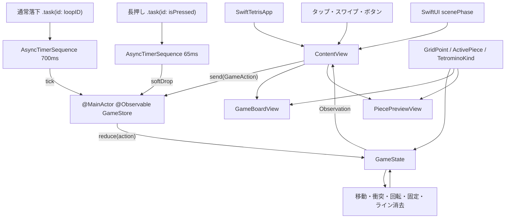
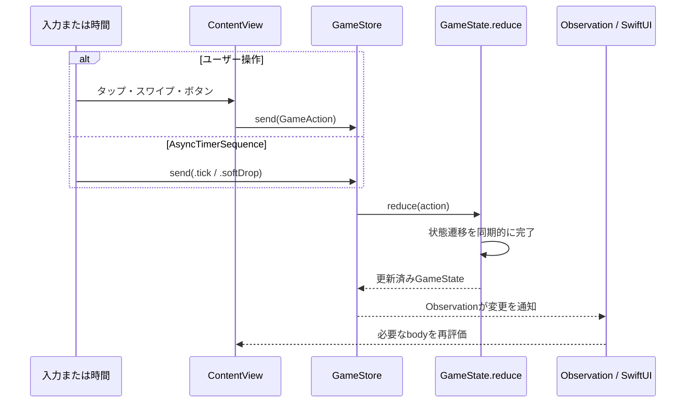

# SwiftTetris

## SwiftUIだけでテトリスを作ったら、状態管理の勉強になりすぎた

SwiftUIの`Grid`で盤面を描画し、Observation、`.task`、Swift Async Algorithmsの`AsyncTimerSequence`でゲームを動かすテトリスです。SpriteKitは使用していません。

## 全体アーキテクチャ

### 設計方針

このアプリは、次の方針で構成しています。

- ゲームの正となる状態は`GameState`だけが所有する
- タップ、スワイプ、ボタン、時間経過をすべて`GameAction`へ変換する
- 状態変更は`GameState.reduce(_:)`だけを通す
- `GameStore`をSwiftUIとゲームドメインの境界にする
- 並行に発生し得る入力も`MainActor`上で直列に処理する
- Taskの生成とキャンセルはSwiftUIの`.task(id:)`へ任せる
- View用の値は可能な限り保存せず、状態から導出する

### コンポーネント構成



| レイヤー | 型・ファイル | 責務 |
| --- | --- | --- |
| App | `SwiftTetrisApp` | アプリのエントリーポイントと`WindowGroup`の生成 |
| Presentation | `ContentView` | レイアウト、入力受付、Taskと画面ライフサイクルの管理 |
| Presentation | `GameBoardView` / `PiecePreviewView` | 状態の描画。ゲーム状態は変更しない |
| Store | `GameStore` | Observation、Action受付、自動落下TaskとReducerの接続 |
| Domain | `GameState` / `GameAction` | 唯一のゲーム状態、状態遷移、ゲームルール |
| Domain Values | `GridPoint` / `ActivePiece` / `TetrominoKind` | 座標、落下中ピース、回転形状を表す値型 |
| Styling | `TetrominoStyle` | テトリミノ種別をSwiftUIの色へ変換 |

依存方向は原則として`View → Store → Domain`です。DomainはSwiftUIのViewを知らず、描画側がDomainの値を読み取ります。例外として色だけは`TetrominoStyle.swift`のextensionでSwiftUI表現へ変換し、ゲームルール本体から分離しています。

### 状態の所有と一方向データフロー

`ContentView`が`@State`として`GameStore`を1つ所有し、`GameStore`が`GameState`を所有します。子Viewには必要な状態を値として渡すため、子Viewが独自のゲーム状態を持つことはありません。



状態遷移の途中をViewへ公開しないため、1つのActionは同期的に最後まで処理されます。たとえば`.tick`は「1段移動」、移動できなければ「固定 → ライン消去 → 次のピース生成 → ゲームオーバー判定」までを1回のReducer呼び出しで完了します。

### Swift Concurrencyの役割

Concurrencyはゲーム状態を複数スレッドで計算するためではなく、「次の時間イベントまで非同期に待つこと」と「待機のライフサイクルを構造化すること」に使っています。

| Task | 所有するView | 起動ID | 間隔 | 送るAction | 終了条件 |
| --- | --- | --- | --- | --- | --- |
| 通常落下 | `ContentView` | `GameLoopID(phase, gameID)` | 700ms | `.tick` | pause、game over、new game、View消滅 |
| 長押し落下 | `SoftDropButton` | `isPressed` | 65ms | `.softDrop` | 指を離す、Button消滅 |

どちらも`AsyncTimerSequence`を`for await`で消費します。待機中はスレッドを占有せず、親となるSwiftUI TaskがキャンセルされるとSequenceも終了します。`Task.detached`や手動で保持する非構造化Taskは作りません。

```swift
.task(id: store.loopID) {
    await store.runGameLoop()
}
```

```swift
let ticks = AsyncTimerSequence.repeating(
    every: state.tickInterval,
    tolerance: .milliseconds(5)
)

for await _ in ticks {
    send(.tick)
}
```

### MainActorとStrict Concurrency

`GameStore`は`@MainActor`です。UI操作と2つのタイマーが近い時刻に発生しても、`send(_:)`とReducerの実行はMainActor上で直列化されます。この規模では共有状態を別actorへ移すより、SwiftUIの隔離領域と状態の所有者を一致させる方が単純です。

`GridPoint`、`ActivePiece`、`TetrominoKind`は`nonisolated`かつ`Sendable`な値型です。将来、AI探索や盤面評価を別Taskへ移す場合も、参照共有ではなく値のコピーを境界にできます。プロジェクトではSwift 6.4、`SWIFT_STRICT_CONCURRENCY = complete`、デフォルトのMainActor隔離を有効にしています。

### ゲームと画面のライフサイクル

`GamePhase`と`gameID`を`GameLoopID`へまとめ、`.task(id:)`の再生成条件にしています。

| 状態変化 | Taskの動作 |
| --- | --- |
| `.running → .paused` | 現在の通常落下Taskをキャンセル。新しいTaskは即終了 |
| `.paused → .running` | 新しい通常落下Taskを開始 |
| `.running → .gameOver` | 通常落下Taskをキャンセル |
| `.newGame` | `gameID`を増やし、以前のTaskをキャンセルして新しいゲーム用Taskを開始 |
| Viewが画面から消える | SwiftUIがViewに紐づくTaskをキャンセル |

アプリがバックグラウンドへ移る場合は、`ContentView`が`scenePhase`を監視して`.pause`を送ります。SwiftUI自身が画面のライフサイクルを提供するため、専用の`AppLifecycleMonitor`は置いていません。

### NotificationとAsyncMessageを使わない理由

現在の入力元はすべて`ContentView`またはその子Viewの管理下にあり、`GameStore`へ直接Actionを送れます。そのため、送信元と受信先の関係を隠す`NotificationCenter`や`AsyncMessage`はゲームループには使っていません。

これらが適するのは、キーボード管理、コントローラー接続、オーディオ、別機能モジュールなど、View階層の外側から複数の購読者へイベントを配信する必要が生じた場合です。その場合も、受信したメッセージを最終的に`GameAction`へ変換し、Reducerの入口は増やさない方針です。

### 描画設計

`GameBoardView`は固定済み盤面と操作中ピースを合成した`visibleCells`、および`ghostCells`を読み取ります。これらは`GameState`に重複保存せず、描画時に導出します。盤面は10×20の`Grid`、プレビューは4×4の`Grid`として構築しています。

`ContentView`は利用可能な幅が700ポイントを超える場合に横長レイアウト、それ以下では縦長レイアウトを選びます。ゲームルールはレイアウトから独立しているため、iPhoneとiPadで同じ`GameState`とReducerを利用できます。

### 外部依存と境界

| 依存 | 用途 |
| --- | --- |
| SwiftUI | View、Observation連携、ジェスチャー、scenePhase |
| Observation | `@Observable`によるStoreの変更追跡 |
| Foundation | `Duration`などの基本型 |
| Swift Async Algorithms | `AsyncTimerSequence`による反復タイマー |

SpriteKit、永続化、ネットワーク通信、Foundation Modelsは現在の実行経路には含めていません。AI探索を追加する場合は、現在の手動操作を置き換えるのではなく、「`GameState`の値を入力として候補Actionを返す別コンポーネント」としてStoreの外側へ配置する想定です。

## LTで扱える状態管理のポイント

### 1. 状態を1か所に集める

盤面、落下中のピース、NEXT、HOLD、スコア、ゲーム進行状態は、値型の`GameState`が所有します。View自身にはゲームルールの状態を持たせません。

```swift
struct GameState {
    private(set) var board: [[TetrominoKind?]]
    private(set) var activePiece: ActivePiece?
    private(set) var nextKind: TetrominoKind
    private(set) var score = 0
    private(set) var phase: GamePhase = .running
}
```

### 2. 状態変更をActionにする

ボタン、ジェスチャー、自動落下は、すべて`GameAction`として同じ入口へ送ります。

```swift
enum GameAction {
    case tick
    case moveLeft
    case moveRight
    case softDrop
    case rotate(clockwise: Bool)
    case hardDrop
    case hold
}
```

### 3. 変更経路を1つにする

状態を変更できるのは`reduce(_:)`だけです。「どの操作で何が変わるか」を1か所から追えます。

```swift
mutating func reduce(_ action: GameAction) {
    switch action {
    case .tick:
        tick()
    case .moveLeft:
        moveActivePiece(x: -1)
    case .hardDrop:
        hardDrop()
    // ...
    }
}
```

### 4. 保存する状態を増やしすぎない

`level`、ゴースト、画面表示用セルは、保存済みの状態から計算する導出状態です。元データとの不整合を防ぎます。

```swift
var level: Int {
    clearedLines / 10 + 1
}

var visibleCells: [[TetrominoKind?]] {
    // 固定済み盤面と落下中のピースを合成
}
```

### 5. Viewは状態を表示してActionを送る

盤面は`Grid`、`GridRow`、`Rectangle`というSwiftUIのView階層をそのまま使っています。

```swift
Grid {
    ForEach(cells.indices, id: \.self) { y in
        GridRow {
            ForEach(cells[y].indices, id: \.self) { x in
                CellView(kind: cells[y][x])
            }
        }
    }
}
```

ユーザー操作も直接状態を書き換えず、Actionを送ります。

```swift
Button {
    store.send(.moveLeft)
} label: {
    Image(systemName: "arrow.left")
}
```

### 6. 時間もActionとして扱う

`.task(id:)`でゲームループのライフサイクルをSwiftUIに任せ、`AsyncTimerSequence`が一定間隔で生成する要素を`for await`で受け取って`.tick`を送ります。画面が消えたりゲームの状態が変わったりすると、古いTaskとタイマー列は自動的にキャンセルされます。

```swift
.task(id: store.loopID) {
    await store.runGameLoop()
}
```

```swift
let ticks = AsyncTimerSequence.repeating(
    every: state.tickInterval,
    tolerance: .milliseconds(5)
)

for await _ in ticks {
    send(.tick)
}
```

落下ボタンの長押しも同じ仕組みです。押下中だけ65ミリ秒間隔のイベント列を読み、指が離れて`.task(id:)`が再起動されると以前の列は終了します。

## 主な機能

- 7種類のテトリミノと7-bag方式
- 一定速度の自動落下、左右移動、SRS準拠の回転
- 短押しで1段、押している間だけ速くなる落下ボタン
- ソフトドロップ、ハードドロップ
- Liquid GlassとSF Symbolsによる操作ボタン
- HOLD、NEXT、ゴースト
- ライン消去、スコア、レベル
- 一時停止、ゲームオーバー、リスタート
- タップ、スワイプ、キーボード操作
- iPhone、iPad対応レイアウト

## ファイル構成

| ファイル | 役割 |
| --- | --- |
| `SwiftTetrisApp.swift` | アプリのエントリーポイントとWindowGroup |
| `GameState.swift` | 唯一のゲーム状態、Action、Reducer、ゲームルール |
| `GameStore.swift` | ObservationとAsyncTimerSequenceによるゲームループ、ViewからのAction受付 |
| `ContentView.swift` | 状態の表示とユーザー操作 |
| `GameBoardView.swift` | GridとRectangleによる盤面描画 |
| `PiecePreviewView.swift` | HOLDとNEXTの描画 |
| `Tetromino.swift` | 座標、種類、回転形状などの値型 |
| `TetrominoStyle.swift` | テトリミノ種別からSwiftUIの色への変換 |

## 動作環境

- Xcode 27
- Apple Swift 6.4
- iOS / iPadOS 27.0+
- Swift Async Algorithms 1.1.5
- Strict Concurrency: Complete

## 実行方法

1. `SwiftTetris.xcodeproj`をXcodeで開きます。
2. `SwiftTetris`スキームを選択します。
3. iPhone Simulator、iPad Simulator、またはiOS/iPadOS実機で実行します。
